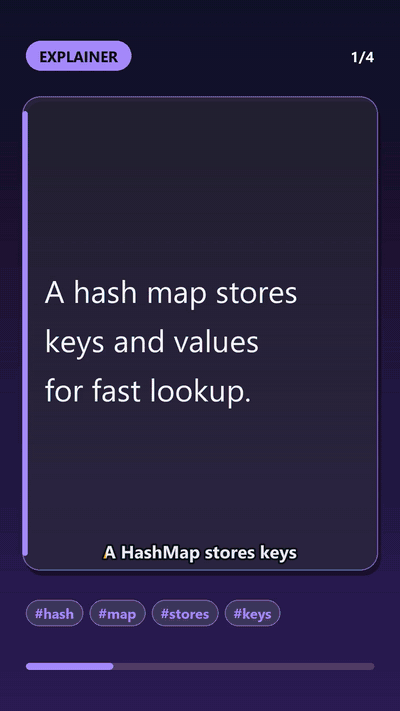

<div align="center">

# TokenReel

**Turn plain text and technical content into animated, narrated, captioned short videos.**
Offline-first. No watermark. No cloud TTS. Secure by default.

[](https://github.com/sunilgentyala/tokenreel/actions/workflows/ci.yml)




</div>

## What it does

Give it Markdown or plain text. TokenReel plans the scenes with NLP, then draws, narrates and
captions them for Shorts and Reels (1080x1920).

| Your text | Scene it becomes |
|---|---|
| Prose | **Explainer** card with keyword chips |
| "First ... Then ... Finally ..." | **Flow** diagram with numbered steps and arrows |
| Equations and numbers (`x = n / m`, `O(1)`) | **Math** card, spoken as words ("n over m") |
| Fenced code blocks | **Code** panel with line numbers and syntax colors |

## Why another video generator

The popular free tools compose stock footage from a topic. They do not animate code, flows or
math, and caption tooling often defaults to cloud TTS that sends your script elsewhere.
TokenReel keeps everything on your machine and is built for technical explainers.

## Quick start

```bash
pip install -e ".[dev]"
tokenreel plan examples/demo.md      # scene plan as JSON, no extras needed
tokenreel srt examples/demo.md       # estimated captions
```

Silent preview video (needs [ffmpeg](https://ffmpeg.org) on PATH and the `render` extra):

```bash
pip install -e ".[render]"
tokenreel render examples/demo.md
```

Narrated video with exact captions burned in:

```bash
pip install -e ".[render,tts,align]"
# download kokoro-v1.0.onnx and voices-v1.0.bin (about 350 MB) from the
# kokoro-onnx "model-files-v1.0" release into ~/.tokenreel/models
tokenreel render examples/demo.md --audio --align --burn
```

Output goes to `build/` as `out.mp4` and `captions.srt`.

## Use it from an AI agent (MCP)

TokenReel ships an [MCP](https://modelcontextprotocol.io) server, `tokenreel-mcp`, so an agent
can plan and render videos for you. It runs locally over stdio.

```bash
pip install -e ".[mcp,render]"
claude mcp add tokenreel -- tokenreel-mcp        # Claude Code
```

Or in any MCP client config:

```json
{ "mcpServers": { "tokenreel": { "command": "tokenreel-mcp" } } }
```

| Tool | What it does |
|---|---|
| `plan_scenes` | Split text into scenes (text, flow, math, code) with keywords and flow steps |
| `make_captions` | Estimated SRT captions |
| `render_video` | Render an mp4 plus captions, optionally narrated, aligned and burned in |

Safety: the client never passes file paths. Output goes to `TOKENREEL_OUT` (default
`~/tokenreel-output`), one new folder per render, with a restricted file name. Input size and
scene count are capped. For sandboxed use there is a container image:
`docker run -i --rm ghcr.io/sunilgentyala/tokenreel:latest` (MCP over stdio).

## How it works

```
text / Markdown
  -> sentence + scene segmentation (code, math, flow, text) and keywords
  -> spoken-form normalization (digits and symbols become words)
  -> local TTS (kokoro-onnx)
  -> word timings (faster-whisper, local; or a calibrated estimate)
  -> frames (Pillow) -> hardened ffmpeg -> mp4 + srt
```

Word-level timing matters because aligners give no time to bare digits or symbols, so
narration text is normalized to spoken words before alignment. When the recognizer hears a
different number of words than the script, its words are used for the captions as-is.

## Security and privacy

- Untrusted input is treated as hostile: paths are confined to a working directory, file
  types are allow-listed, ffmpeg runs with list arguments, `-protocol_whitelist file` and a
  timeout, and untrusted URLs never reach ffmpeg (see CVE-2023-6605 for why).
- Run rendering in a container, ideally with gVisor, with no network and resource limits.
- Releases ship a CycloneDX SBOM, build provenance attestations and Sigstore signatures.
- Telemetry is off by default and opt-in only. See [TELEMETRY.md](TELEMETRY.md).
- Report vulnerabilities privately. See [SECURITY.md](SECURITY.md).

## Design notes

- Rendering is our own frame generator plus ffmpeg, not Remotion. Remotion's license requires
  a paid company license for larger organizations, which would burden operators of a
  self-hosted tool.
- The core installs with zero dependencies. NLP, TTS, alignment and rendering are optional
  extras.

## Status and roadmap

Early alpha (v0.1.0). Done: scene planning, flow diagrams, offline narration, exact word
timings, burned-in captions. Next: math typesetting, architecture diagrams, more voices and
languages, a 16:9 layout, per-word caption highlighting.

## License

Apache-2.0. See [LICENSE](LICENSE).
